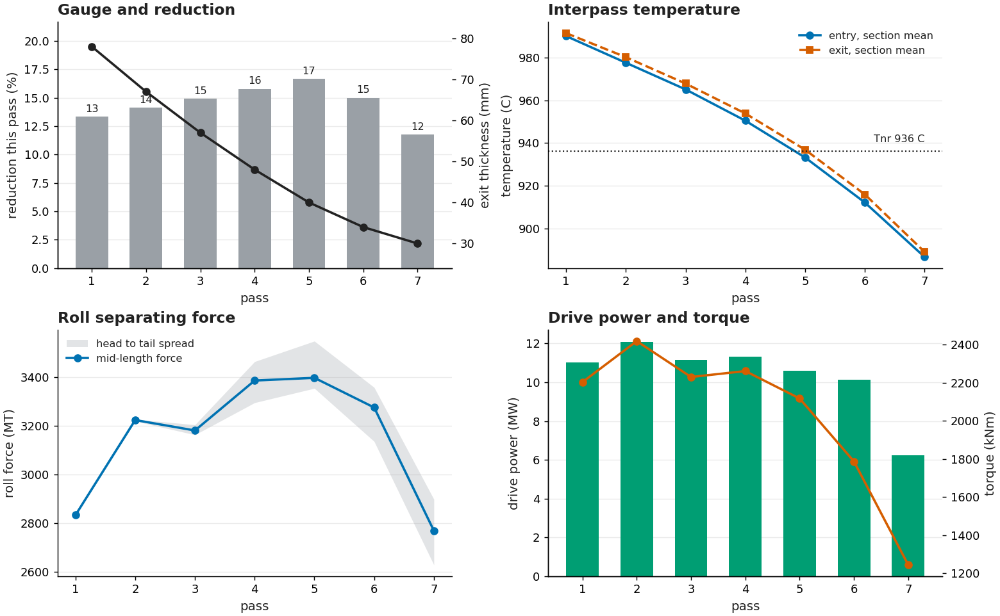
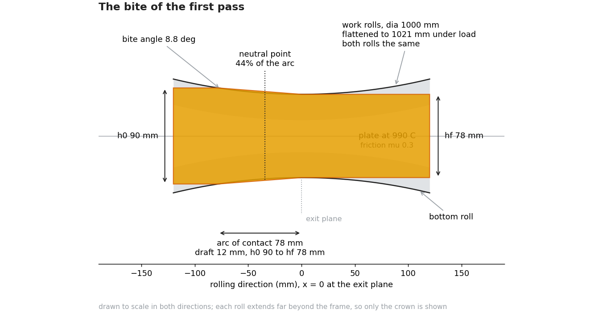
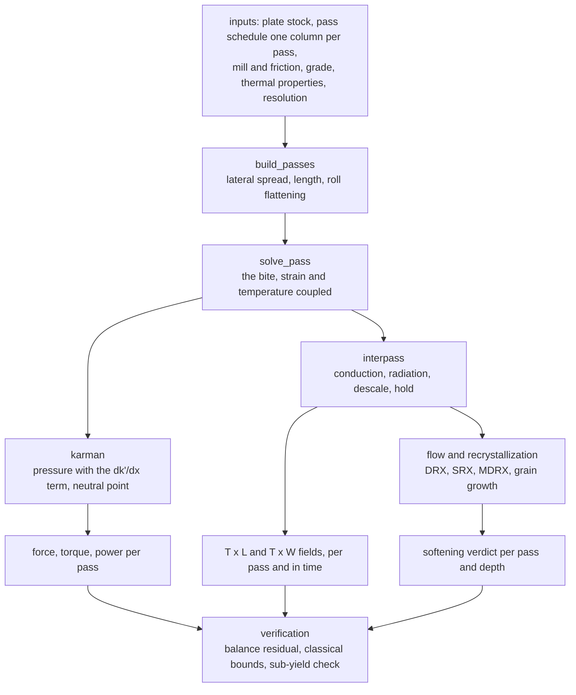
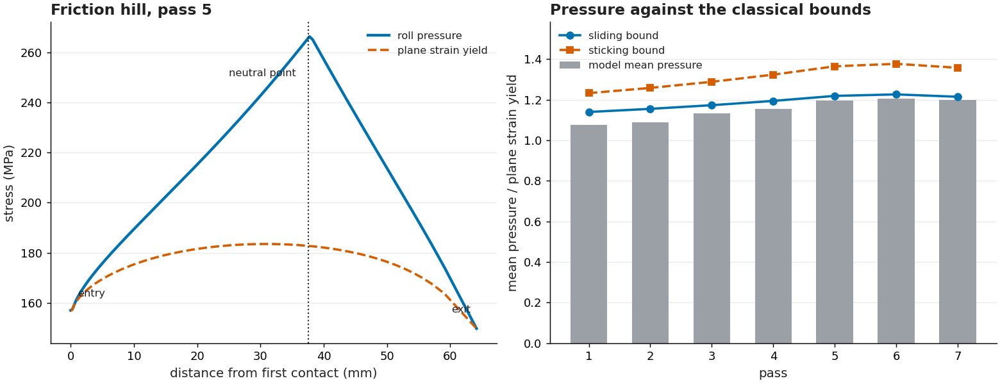
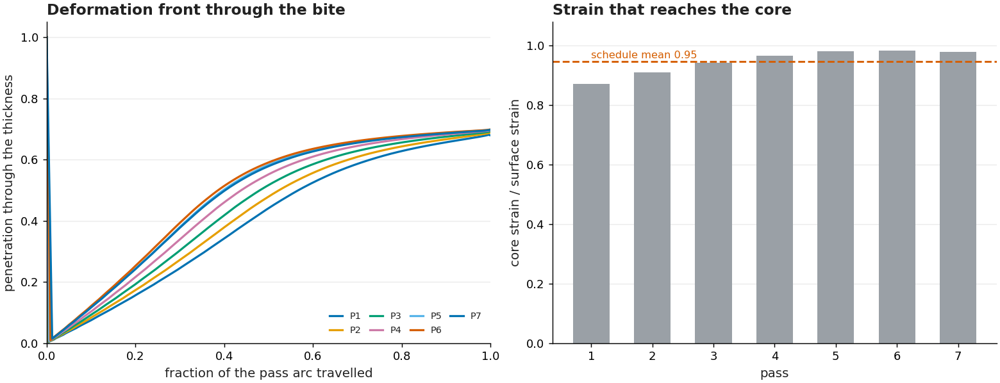
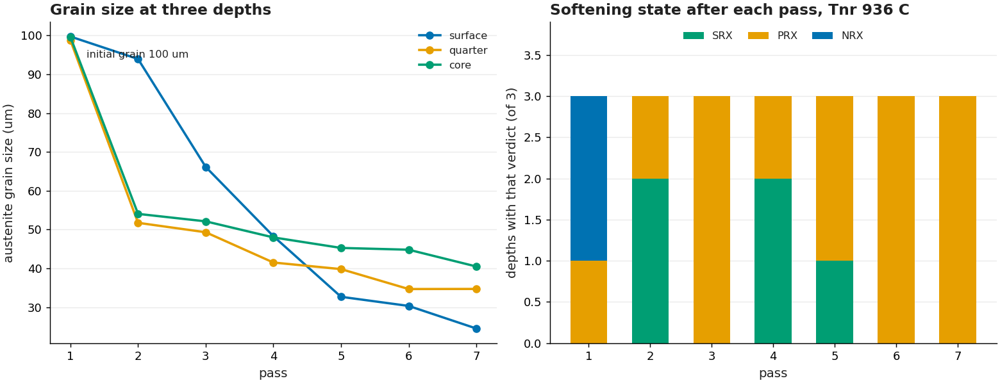

# Hot rolling pass simulation on a 4Hi reversible plate mill

What seven passes do to a 90 mm plate: the roll force the mill has to carry, how far the deformation
reaches through the thickness, how much heat leaves the plate between passes, and what the austenite
does while it waits. One self-contained notebook, no data files, about fifteen seconds to run.

The middle of the schedule is where it gets interesting. The plate is thinnest and coldest late, the
strain stops reaching the core, and the section steps below the non-recrystallization temperature at
the fifth pass, which is the point where the schedule stops refining the austenite and starts
flattening it.

## Run it

[](https://colab.research.google.com/github/daniswaramp/steel-plate-roll-force-model/blob/main/rolling_mill_pass_simulation.ipynb)

Colab already has numpy, scipy, pandas, matplotlib and plotly, which is the whole import list. A full
run takes about fifteen seconds: seven passes, each solved station by station through the bite, with
the interpass wait integrated between them.

```
pip install -r requirements.txt
jupyter lab rolling_mill_pass_simulation.ipynb
```

## What is here

```
rolling_mill_pass_simulation.ipynb   the model, a numbered section per step
scripts/make_figures.py              redraws the four charts below from the notebook's own engine
scripts/make_schematics.py           draws the bite schematic, geometry as named constants
figures/                             the five pictures in this README
rolling_outputs/                     the three animations as standalone pages
requirements.txt
```

## The schedule it ships with

A 90 mm plate, 2400 mm wide and 4.0 m long, at 990 C at first contact, rolled to 30 mm in seven
passes on one reversing stand. Every pass is editable on its own: draft, entry temperature, thread
speed, roll diameter, the wait before it and the descaling spray.

| | |
| :--- | ---: |
| Entry to exit thickness | 90 to 30 mm, 67 per cent |
| Plate after the last pass | 11.7 m long, 2468 mm wide by lateral spread |
| Heaviest draft, tightest bite limit | 12 mm against 46 mm at mu 0.3 |
| Roll force at mid-length | 2769 MT (pass 7) to 3397 MT (pass 5) |
| Peak drive power, peak torque | 12.1 MW, 2419 kNm |
| Roll gap setting below target, heaviest pass | 3.7 mm at a 9 MN/mm mill modulus |
| Tnr, first crossing at the core | 936 C, during pass 5 |
| Core temperature after the last pass | 938 C, against a 603 C skin at the coldest bite |
| Grain size, core and surface | 100 to 40 um and 24 um |
| Softening verdicts, 21 labels | 5 SRX, 14 PRX, 2 NRX, none reaching DRX |



Force climbs while the plate thins, because the flow stress climbs faster than the contact area
falls, and it stays high in the light late passes: pass 7 removes 4 mm and still asks for 2769 MT.
The shaded band is the head to tail spread inside one pass, 270 MT at its widest.

## The bite we solve



The roll radius in the drawing is the flattened one, 1021 mm against 1000 mm cold, because that is
the radius the strip meets. Only the crown of each roll is in frame; every length is drawn to scale.

## The equations

The bite is the von Karman slab equilibrium [1], with $x$ measured from the exit plane, $k' = 1.155\,\bar\sigma$
the plane strain yield stress and the friction shear $\tau = \min(\mu p,\; 0.45\,k')$. The pressure field, the
friction hill and the classical bounds quoted further down follow the treatment in [2]:

$$\frac{dp}{dx} = \frac{dk'}{dx} + \frac{2k'\tan\varphi \mp 2\tau}{h} \qquad [1]$$

minus on the entry side, plus on the exit side. The $dk'/dx$ term is the flow stress changing along one
arc, and it is not optional here: the yield stress climbs tens of MPa as the strain accumulates and
falls again where DRX softens the austenite. It is the varying-flow-stress generalisation of the 1925
equation, which assumed $k$ constant, and it is given in this form in [2]. Dropped, the pressure dips
below the local yield stress through the middle of the bite and the strip is no longer in horizontal
equilibrium. Both branches are marched from their own end plane, where $p = k'$, and the neutral point
is where they meet.

The geometry, with the flattened radius $R'$ and the draft $\Delta h = h_0 - h_f$:

$$h(\varphi) = h_f + 2R'(1-\cos\varphi), \quad x = R'\sin\varphi, \quad
L_d = \sqrt{R'\Delta h - \Delta h^2/4}, \quad \cos\alpha = 1 - \frac{\Delta h}{2R'}, \quad
\Delta h_{max} = \mu^2 R' \qquad [2]$$

$L_d$ the arc of contact, $\alpha$ the bite angle, and Hitchcock flattening $R' = R(1 + C F'/\Delta h)$ [3]
with $C = 2.2\times10^{-5}$ mm²/N and $F'$ the force per unit width. The flattening relation is
Hitchcock's; the value of $C$ is the one this model uses.

The flow stress and the DRX thresholds, with $Z = \dot\varepsilon \exp(Q/RT)$, $Q = 312$ kJ/mol,
$A = 3.0\times10^{11}$, $\alpha = 0.012$, $n = 4.5$:

$$\sigma_p = \frac{1}{\alpha}\sinh^{-1}\left[\left(\frac{Z}{A}\right)^{1/n}\right] \qquad [4], [5]$$

The hyperbolic sine law is Sellars and Tegart [4]. The constants are those of [5]: $\alpha$ and $Q$ as
tabulated there for C-Mn steel, and $A$ and $n$ close to its Nb-bearing set, which prints $3.43\times
10^{11}$ with $n = 4.5$ against the $3.0\times10^{11}$ used here. The C-Mn base steel of the same study
prints $5.2\times10^{11}$ with $n = 4.93$ for the dynamic-recrystallization steady state, which puts the
peak stress about 10 per cent lower at the temperatures and rates of this schedule. The consequence of
that choice is in the limits below.

$$\varepsilon_c = 4.9\times10^{-4} d_0^{0.5} Z^{0.15}(1 + 40\,\mathrm{Nb}), \qquad
\varepsilon_p = \varepsilon_c/0.8 \qquad [6]$$

The critical strain follows the C-Mn form of Sellars [6], and the ratio $\varepsilon_p =
\varepsilon_c/0.8$ is also his. Note that the same coefficient circulates in the literature attached to
the peak strain rather than the critical strain; which variable it defines is decided by the 0.8
factor, and this notebook takes it as the critical strain. The $(1 + 40\,\mathrm{Nb})$ factor is this
grade's own addition: no source stating that multiplicative form was found, and it is listed among the
limits below.

$$X_d = 1 - \exp\left[-0.693\left(\frac{\varepsilon - \varepsilon_c}{\varepsilon_p}\right)^2\right],
\qquad \sigma = \sigma_h(\varepsilon) - X_d\,(\sigma_p - \sigma_{ss}) \qquad [6]$$

The through-thickness strain profile, the strain and the rate at a station are

$$g(s) = m + (1-m)e^{-(s/\delta)^2}, \qquad \bar\varepsilon = \tfrac{2}{\sqrt3}\ln(h_0/h), \qquad
\dot\varepsilon = \tfrac{2}{\sqrt3}\frac{v_{out}h_f}{h^2}\left|\frac{dh}{dx}\right|$$

with $s$ the distance from the nearest face, $\delta = \kappa\ell$ the penetration depth after an arc
length $\ell$, and the shape factor $\Delta = h_m/L_d$ entering $m = 1/[1 + 3\max(\Delta-0.4,0)^2]$.
This profile is this notebook's own. It is not the output of a finite element solution and no source
states it; $\kappa$ is a free constant set in the inputs.

Between passes the static softening is the C-Mn law of Sellars [6] carrying the Nb solute-drag factor
of Dutta and Sellars [7], applied by the additive rule of Beynon and Sellars [8],
$X = 1 - \exp(-0.693\theta^2)$, $d\theta/dt = 1/t_{0.5}$:

$$t_{0.5}^{SRX} = 2.5\times10^{-19}\,\varepsilon^{-4} d_0^2
\exp\left(\frac{300000}{RT}\right)\exp\left[\left(\frac{2.75\times10^5}{T} - 185\right)\mathrm{Nb}\right]
\qquad [7]$$

$$t_{0.5}^{MDRX} = 1.1\,Z^{-0.8}\exp\left(\frac{230000}{RT}\right) \qquad [9], [10]$$

The metadynamic half time is as printed by Maccagno, Jonas and Hodgson [9], with the exponent and the
activation energy confirmed against Hodgson and Gibbs [10]. Beynon and Sellars [8] state the $0.693$
coefficient with an additive time-temperature treatment and put the Avrami exponent in the range 1 to
2; the exponent of 2 used here is the top of that range and is this model's choice.

The recrystallized grain sizes are $d = 1.8\times10^3 Z^{-0.15}$ for dynamic recrystallization, as
compiled in [11], and $d = 1.6\times10^4 Z^{-0.23}$ after metadynamic recrystallization [10]. The static
form $d_{srx} = 1.1\,d_0^{0.67}\varepsilon^{-0.67}$ has no source either of us could verify and is this
notebook's own fit. Grain growth is $d^7 - d_0^7 = K_g t \exp(-Q_g/RT)$ with $K_g = 1.5\times10^{27}$
and $Q_g = 400$ kJ/mol, the C-Mn rows of Hodgson and Gibbs [10].

The non-recrystallization temperature is Boratto [12],

$$T_{nr} = 887 + 464\,C + (6445\,Nb - 644\sqrt{Nb}) + (732\,V - 230\sqrt{V}) + 890\,Ti + 363\,Al - 357\,Si \qquad [12]$$

Composition in weight per cent, temperatures in C, lengths in mm, stress in MPa, time in s. Heat
enters through the plastic work, $\eta\sigma\dot\varepsilon$ with $\eta = 0.9$, the inelastic heat
fraction a coupled thermal-stress model is normally run with [13], and leaves through the roll contact
at 20000 W/m²K, radiation and convection between passes, and a 5000 W/m²K spray while descaling. The
roll-contact figure sits inside the roll-gap range of 15 to 26 kW/m²K measured on a pilot mill [14] and
inside the 6 to 45 kW/m²K spanned by published values in [15]. The descaling coefficient and the
emissivity of 0.80 are this model's own values: [15] identifies the descaling coefficient per mill from
thermocouple data and states it transfers poorly to another mill, and a fixed emissivity for a hot
plate is not something those records fix, placing it between 0.80 and 0.83. The share of plastic work
that becomes heat is measured lower than 0.9 and varies with material and rate [16]; 0.9 is kept here
because it is the value a thermal model is normally run with.

## The route



## What it finds



The pressure rises from the yield stress at both end planes to a peak at the neutral point, and the
neutral point sits 41 to 45 per cent of the arc back from the exit through the whole schedule. The
mean pressure runs 1.08 to 1.21 times the plane strain yield. The classical constant-flow-stress
bounds for the same passes are 1.14 to 1.38, so the model sits just under the sliding bound, which is
what a flow stress falling towards the exit does to a bound that assumes it constant.



The deformation front never reaches the core inside one pass arc, and the core carries 0.87 to 0.98 of
the surface strain. Heavier drafts and a colder plate push the front deeper; the light late passes
work on a skin.



The section crosses Tnr during pass 5, and from there the austenite is partly recrystallized at best:
of 21 labels across three depths and seven passes, 5 are fully softened, 14 partly and 2 not at all,
and no pass reaches the DRX critical strain of 0.54. Grain size still falls from 100 um to 40 um at
the core, because the early passes above Tnr do the work.

Across the width the edge is 32.8 C colder than the centre on average and carries up to 17.0 per cent
more force per unit width. Along the length, the head to tail force difference changes sign with the
rolling direction, -126 MT on the forward passes and +128 MT on the reverse ones.

## Verification

Every number below is printed by the notebook, in the section named beside it.

| Check | Result |
| :--- | :--- |
| Horizontal balance of the strip, heaviest pass | 65 per cent at the shipped 0.05 mm bite step |
| The same balance at a 0.01 mm step | 6 per cent, so the rest is quadrature, not a missing term |
| Pressure below the local plane-strain yield | at most 2.0 MPa, on no pass |
| Mean pressure against the classical bounds | 1.08 to 1.21 against 1.14 to 1.38 |
| Bite limit against the heaviest draft | 46 mm against 12 mm at mu 0.3 |
| Core against surface strain | 0.87 to 0.98 |
| Energy ledger over the schedule | +36 C of work and friction against -137 C of losses |

The balance residual is the honest way to read the pressure field: a coarse step leaves 65 per cent,
and refining the step on the same pass takes it to 6 per cent, which is what a quadrature error looks
like. A missing term would hold the residual at that size however fine the step got.

## Methods and tools

- Python 3.14 with numpy, scipy sparse, pandas, matplotlib and plotly. The interpass wait is an
  implicit sparse conduction solve; the bite is a march in 0.05 mm indentation steps over a 41 node
  through-thickness grid.
- The notebook is self-contained: it reads nothing and writes only the three animation pages in
  `rolling_outputs/`.
- `scripts/make_figures.py` executes the notebook headlessly and redraws the charts in this README
  from its own arrays, so a figure cannot drift from the model. `scripts/make_schematics.py` draws the
  bite from named constants.
- The stored outputs in the notebook come from a full run, so the tables and figures are visible
  without running anything.
- Headless re-run: `python -m nbconvert --to notebook --execute --inplace rolling_mill_pass_simulation.ipynb`.

## What it does not settle

The model is physical but it is not calibrated to one mill.

- The flow stress, DRX and static softening constants come from the C-Mn and Nb-bearing tables of the
  sources cited above rather than from this grade. They fix the shape of the result but not the absolute
  force. Taking the C-Mn base set of [5] instead of the set used here lowers the peak stress about 10
  per cent at this schedule's temperatures and rates, and one plant force measurement per pass would
  settle the scaling.
- The through-thickness strain profile is a penetration law with one free constant, not a finite
  element solution, so it carries the trend and not the local shear bands.
- Lateral spread is a single coefficient and the edge has the same strain state as the centre. Real
  edges see plane stress.
- The roll gap is treated as flat: no work-roll bending, no crown, no edge drop, so the force is
  uniform in the width sense of the model.
- Roll contact and descaling heat transfer coefficients are single values, where water film and scale
  thickness would move them between passes.
- A reheat written into the schedule resets the section to one temperature, so it cannot show the
  gradient a real furnace leaves behind.
- The critical strain for DRX is sensitive to its grain-size exponent and to the Nb coefficient.
  Changing either moves which passes could recrystallize.
- The critical strain coefficient in [6] circulates in the literature attached to the peak strain as
  well as to the critical strain. Read as the peak strain, the critical strain used here is 25 per cent
  high, which moves which passes recrystallize.
- Six values in the inputs have no source that states them: the (1 + 40 Nb) factor, the 0.45 k' cap on
  the friction shear, the descaling coefficient of 5000 W/m²K, the emissivity of 0.80, the Avrami
  exponent of 2, and the penetration depth constant kappa. They are this notebook's choices, and each is
  named where it is used.
- The dynamic recrystallized grain size 1.8e3 Z^-0.15 is quoted from the compiled tables of [11]. The
  paper that first fitted that form could not be identified.

The notebook lists these in its own closing section, with what it would take to close each one.

## References

[1] T. von Kármán, "Beitrag zur Theorie des Walzvorganges," *Zeitschrift für Angewandte Mathematik und
Mechanik*, vol. 5, no. 2, pp. 139-141, 1925, doi: 10.1002/zamm.19250050213.

[2] J. G. Lenard, M. Pietrzyk, and L. Cser, *Mathematical and Physical Simulation of the Properties of
Hot Rolled Products*, 1st ed. Amsterdam, The Netherlands: Elsevier, 1999.

[3] J. H. Hitchcock, "Roll neck bearings," Report of the ASME Special Research Committee on Heavy-Duty
Anti-Friction Bearings, American Society of Mechanical Engineers, New York, NY, USA, 1935, pp. 33-41,
roll flattening in the roll gap.

[4] C. M. Sellars and W. J. McG. Tegart, "Hot workability," *International Metallurgical Reviews*,
vol. 17, no. 1, pp. 1-24, 1972, doi: 10.1179/imtlr.1972.17.1.1.

[5] A. Laasraoui and J. J. Jonas, "Prediction of steel flow stresses at high temperatures and strain
rates," *Metallurgical Transactions A*, vol. 22, no. 7, pp. 1545-1558, 1991, doi: 10.1007/BF02667368.

[6] C. M. Sellars, "Modelling microstructural development during hot rolling," *Materials Science and
Technology*, vol. 6, no. 11, pp. 1072-1081, 1990, doi: 10.1179/mst.1990.6.11.1072.

[7] B. Dutta and C. M. Sellars, "Effect of composition and process variables on Nb(C, N) precipitation
in niobium microalloyed austenite," *Materials Science and Technology*, vol. 3, no. 3, pp. 197-206,
1987, doi: 10.1179/mst.1987.3.3.197.

[8] J. H. Beynon and C. M. Sellars, "Modelling microstructure and its effects during multipass hot
rolling," *ISIJ International*, vol. 32, no. 3, pp. 359-367, 1992, doi: 10.2355/isijinternational.32.359.

[9] T. M. Maccagno, J. J. Jonas, and P. D. Hodgson, "Spreadsheet modelling of grain size evolution
during rod rolling," *ISIJ International*, vol. 36, no. 6, pp. 720-728, 1996,
doi: 10.2355/isijinternational.36.720.

[10] P. D. Hodgson and R. K. Gibbs, "A mathematical model to predict the mechanical properties of hot
rolled C-Mn and microalloyed steels," *ISIJ International*, vol. 32, no. 12, pp. 1329-1338, 1992,
doi: 10.2355/isijinternational.32.1329.

[11] U. Hanoglu and B. Šarler, "Developments towards a multiscale meshless rolling simulation system,"
*Materials*, vol. 14, no. 15, art. no. 4277, 2021, doi: 10.3390/ma14154277, compiled C-Mn coefficient
tables.

[12] F. Boratto, R. Barbosa, S. Yue, and J. J. Jonas, "Effect of chemical composition on the critical
temperatures of microalloyed steels," in *Proc. Int. Conf. on Physical Metallurgy of Thermomechanical
Processing of Steels and Other Metals (THERMEC-88)*, I. Tamura, Ed. Tokyo, Japan: Iron and Steel
Institute of Japan, 1988, pp. 383-390.

[13] Dassault Systèmes, *Abaqus Analysis User's Guide*, Section 6.5.4, "Fully coupled thermal-stress
analysis," inelastic heat fraction, default value 0.9, 2024.

[14] N. Legrand, N. Labbé, D. Weisz-Patrault, A. Ehrlacher, T. Luks, and J. Horsky, "Analysis of roll
gap heat transfers in hot steel strip rolling through roll temperature sensors and heat transfer
models," *Key Engineering Materials*, vols. 504-506, pp. 1043-1048, 2012,
doi: 10.4028/www.scientific.net/KEM.504-506.1043.

[15] K. Speicher, A. Steinboeck, D. Wild, T. Kiefer, and A. Kugi, "An integrated thermal model of hot
rolling," *Mathematical and Computer Modelling of Dynamical Systems*, vol. 20, no. 1, pp. 66-86, 2014,
doi: 10.1080/13873954.2013.809364.

[16] G. I. Taylor and H. Quinney, "The latent energy remaining in a metal after cold working,"
*Proceedings of the Royal Society A*, vol. 143, no. 849, pp. 307-326, 1934.
